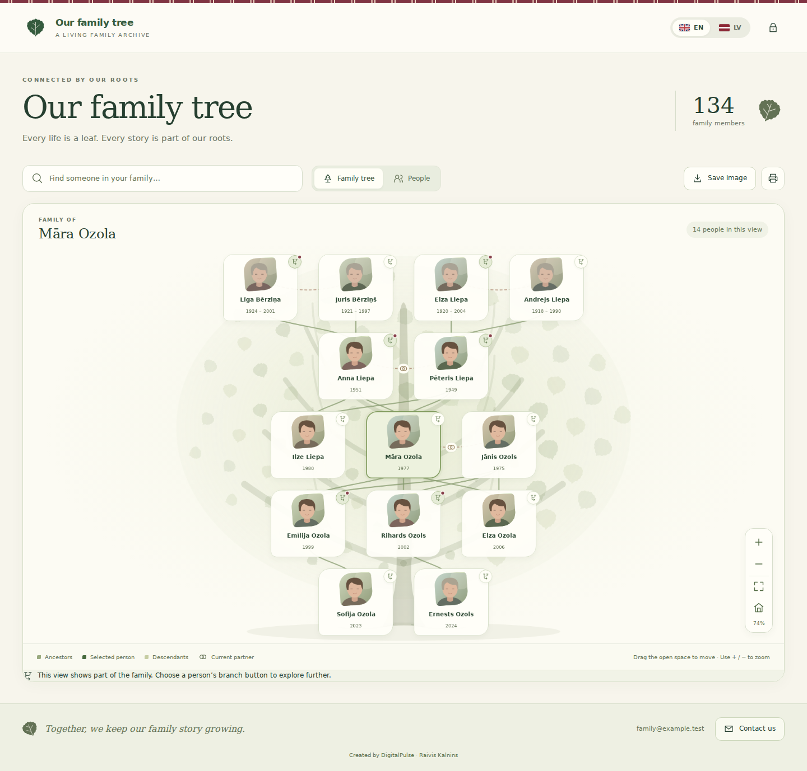

# WP My Family Tree

A WordPress family tree with an oak-inspired React interface, private person dialogs, photo galleries, and English / Latvian language support.

**Version 1.0.2** · **WordPress 6.5+** · **PHP 7.4+** · **GPL-3.0-or-later**  
Developed by **Raivis Kalnins**, web developer at [DigitalPulse](https://digitalpulse.click/).



*The screenshot uses fictional people and illustrated demo portraits. It contains no private family records or photographs.*

## What changed in 1.0.2

- People can have explicitly recorded current, divorced, separated or former partners. A current partner appears beside the selected person with a paired-rings symbol; the symbol means **current partner**, without assuming marriage.
- Former partners are omitted from each other's partner branch. Selecting their shared child still shows both recorded parents and their parent-to-child lines, without a current-partner symbol between them.
- Existing parent links are preserved. Sharing a child does not by itself label two people as a current couple, and a current partner is not automatically made a child's parent.
- Partner statuses are available in English and Latvian in the person editor and follow the person's Polylang translations.

### Included fixes from 1.0.1

- Framed portraits and gallery previews align to the top of each image. Tree portraits use proportionally resized images so an older square thumbnail does not hide the top of the original photograph. The lightbox still shows the whole image.
- When English and Latvian are configured in Polylang, the tree follows the current page language. Its switch uses Polylang's translated page URLs, keeping the theme, page language and tree interface together. The independent EN / LV interface remains available when Polylang is absent or unconfigured.
- The contact form has a 16 px gap between its privacy note and the Send button.
- The repository preserves the folders required by the plugin, and this README displays the included screenshot directly on GitHub.

## Features

- A responsive oak tree with leaf-shaped portraits, branch navigation, pan, zoom and search.
- A person dialog with a biography, dates, locations, relationships and a gallery lightbox.
- Ordinary WordPress posts for people, with the Gutenberg editor for biography content.
- A **Family Tree** block and the `[wp_my_family_tree]` shortcode.
- Optional full-window layout with its own title, header and contact footer, independent of the active WordPress theme.
- Compatibility with the original WP Family Tree category and relationship/date fields.
- Explicit current/former partner status, with current-partner rings and preserved parentage after divorce or separation.
- Optional password access with remembered viewing sessions lasting up to 30 days.
- Authenticated delivery of encrypted family media and no-store responses for protected data.
- A Contact Us dialog with optional hCaptcha and WordPress mail delivery.
- English and Latvian interfaces, optional Polylang content translations, and configurable titles and colours.
- PNG export and printing with the tree title and contact footer.

## Install

1. Download the installable plugin ZIP, or place the repository's files in `wp-content/plugins/wp-my-family-tree/` while preserving the folder structure below.
2. Activate **WP My Family Tree** under **Plugins**. If the original **WP Family Tree** plugin is active, deactivate that older plugin to avoid shortcode conflicts.
3. Open **Family Tree → Settings & help**. Select the family category and starting person.
4. Add the **Family Tree** block or shortcode to a page and choose that page in the plugin settings.
5. Configure a family password and contact details. New private installations remain locked until a password is set.
6. Open the page in a signed-out browser window and check the chosen access settings.

This repository contains a **plugin**. It works with Twenty Twenty-Five and other compatible WordPress themes. Full-window mode supplies the family page layout; switching off that setting embeds the tree inside the theme.

### Shortcodes

```text
[wp_my_family_tree]
[wp_my_family_tree root="123"]
[wp_my_family_tree view="list"]
```

`root` is a WordPress person-post ID. The legacy `[family-tree]` and `[family-members]` shortcodes remain supported for migration.

## English, Latvian and Polylang

Polylang is optional. Without configured Polylang languages, the plugin's EN / LV control changes the interface and stores that choice in the page URL.

For language switching that also follows the theme:

1. Install and activate [Polylang](https://wordpress.org/plugins/polylang/).
2. Add English (`en`) and Latvian (`lv`) under **Languages**. Choose the desired default language. The WordPress locale for Latvian is `lv`.
3. Assign a language to the original tree page. Create its translated page with the same block or shortcode, then link the two pages as translations in Polylang.
4. Keep the English and Latvian titles and introductions in **Family Tree → Appearance**. Registered title and subtitle translations can also be managed in Polylang's string translations.
5. Keep the plugin's language switch enabled. It will use the native translated page URLs. A theme language switch using Polylang will select the same page language.

The plugin preserves names and biographies as entered. It uses a published linked biography translation when available and otherwise shows the original record. It does not duplicate people or machine-translate family histories. A stale `wpmft_lang` query parameter does not override the current Polylang page language.

This integration uses languages on the same site, such as `/` and `/lv/dzimtas-koks/`. The exact paths follow Polylang's URL settings. Separate language domains or subdomains are not supported by this release's origin checks and viewing-session cookies.

See the [official Polylang function reference](https://polylang.pro/documentation/support/developers/function-reference/) for the native page-language and translation APIs used by this integration.

## People and photographs

Create or edit a normal WordPress post. Use its title for the person's name, the block editor for the biography, and a featured image for the portrait. The **Family tree — person details** panel provides dates, locations, parents, partners and gallery controls.

### Current and former partners

In the person details panel, add a partner-status row, select the other person, and choose **Together**, **Divorced**, **Separated** or **Former partner**. Save the post. The status is read in both directions, so saving it on one person is sufficient. Editing a person does not silently change the other person's post.

Choose **Together** for the current partner. Only an explicit current relationship receives the paired-rings symbol. Legacy spouse links without a new status remain neutral partner links, and two people linked only through a shared child remain co-parents.

A divorced, separated or former partner does not appear as the selected person's partner. When their child is selected, both recorded parents remain visible. Father and mother fields continue to determine parentage: adding a new partner never creates a parent link for that partner's children.

If both person records explicitly declare conflicting statuses, a former status takes precedence so the pair is not incorrectly shown as current. Review both records and make their statuses agree to resolve the conflict. The editor shows status context from the other record.

Image frames use `object-position: center top`. This controls the visible part of a proportionally resized source. It cannot recover content already removed from an original photograph; upload the uncropped original if a source file itself is cropped. The gallery lightbox shows the full available image.

## Privacy and backups

The family password permits viewing. Editing still requires an appropriate WordPress account. Remembered access uses a server-validated cookie; the family password is not stored in browser local storage. Changing the password or revoking access invalidates existing viewing sessions.

Keep the database and encrypted uploads together in backups: the database contains the key required to decrypt those files. Keep the plugin active while relying on its protection. Deactivating it can make originally published person text accessible through WordPress again; use separate site access protection before maintenance that disables it.

Old public image URLs, third-party copies and caches are outside the plugin's control. Exclude private tree and media requests from host/CDN caches and review any older public copies after migration.

**Keep databases, Updraft backups, real family media, passwords, encryption keys and production configuration out of this public Git repository.** The included screenshot is safe demonstration content.

## Contact form and optional services

Set the recipient in **Family Tree → Contact & hCaptcha**. Messages use `wp_mail`; delivery depends on the site's mail configuration. The plugin does not store message bodies as family records. A host or mail-logging plugin may retain its own copies.

hCaptcha is disabled by default. Enabling it requires your own site key and secret and loads hCaptcha's browser service. The secret is verified only on the server. See [hCaptcha privacy](https://www.hcaptcha.com/privacy) and [terms](https://www.hcaptcha.com/terms).

## Repository layout

| Path | Purpose |
| --- | --- |
| `wp-my-family-tree.php` | Plugin entry point and WordPress hooks |
| `includes/` | Data, privacy, media, AJAX, settings and person editing |
| `assets/` | Readable React interface, editor scripts and styles |
| `templates/standalone.php` | Optional full-window page template |
| `languages/` | English source strings and Latvian translation catalogs |
| `docs/screenshot.png` | Public demonstration screenshot used above |
| `block.json` | Gutenberg block registration |
| `wpml-config.xml` | Translation rules for person fields |
| `readme.txt` | WordPress.org-format description and changelog |
| `HELP.txt` | Full installation and administration guide |

Keep these directories intact when uploading through Git or installing the plugin. Flattening the files into the repository root breaks the PHP include and asset paths.

No JavaScript build step is required. The frontend uses WordPress's bundled `wp-element` React APIs. The readable PHP, JavaScript and CSS are the source used at runtime.

## Release and licensing

Use the installable plugin archive for WordPress's plugin uploader. UpdraftPlus database/plugins/themes archives belong in the UpdraftPlus restore screen and must not be committed here. A ZIP containing only changed files is for a careful file replacement workflow, not WordPress's full-plugin replacement uploader.

Before a public release, check the actual ZIP in the supported WordPress/PHP environments, run Plugin Check, and verify the WordPress.org contributor account and assigned slug. No automated check constitutes directory approval.

Copyright © 2026 Raivis Kalnins / DigitalPulse. Licensed under the [GNU General Public License, version 3 or later](LICENSE). Legacy-data compatibility refers to WP Family Tree by Arvind Shah; this plugin retains that data model without requiring the older runtime.
